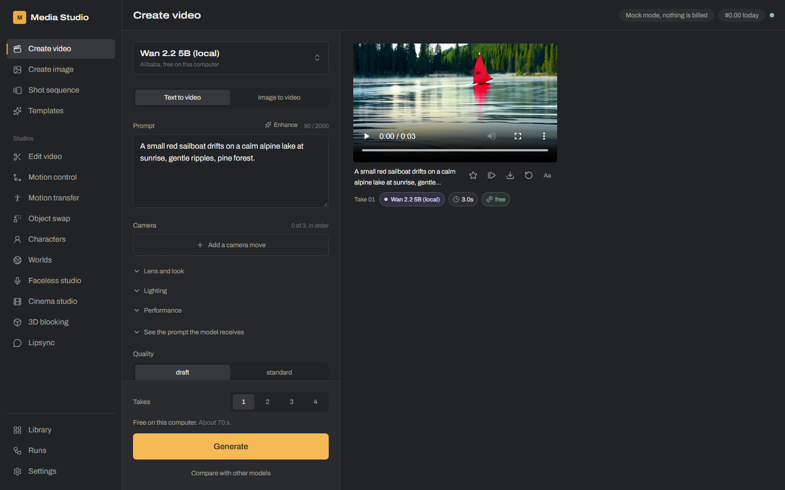
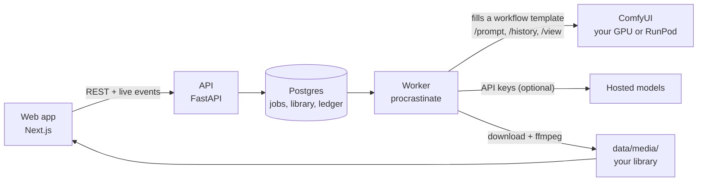
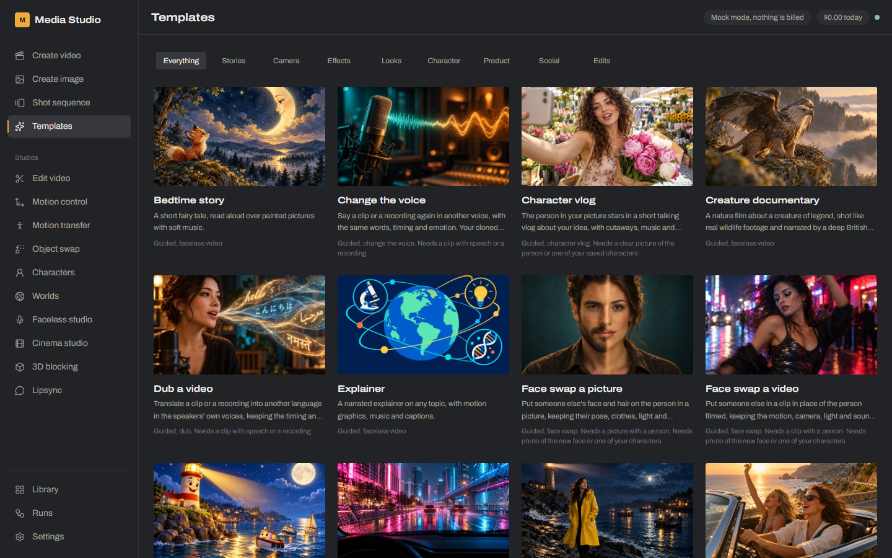
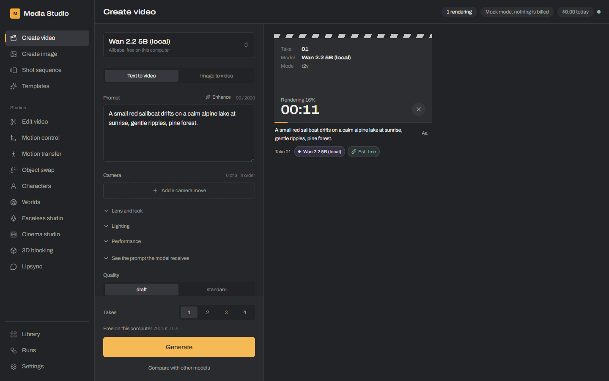
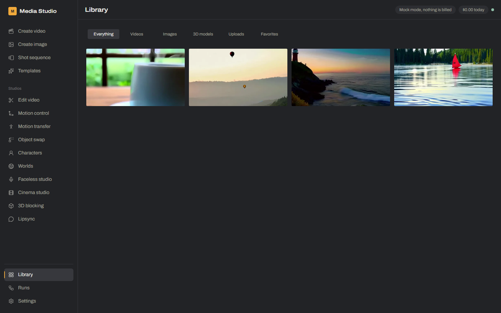

# Opsis

An open-source, self-hosted AI video studio in the spirit of Higgsfield. Write a prompt, pick a model and a few
meaningful controls, watch the job progress, and get the clip in your library, without wiring a node graph by
hand. Behind the forms, the studio runs real ComfyUI graphs on your own GPU (or on RunPod) and, when you add
keys, hosted models from fal.ai, Google, Runway, ElevenLabs and others.





## What it does

| Studio | What you get |
|---|---|
| **Create video and image** | Text or picture to video and image, across local, RunPod and hosted models, with a camera and look director |
| **Edit video, Motion control, Motion transfer** | Restyle a clip, draw motion paths on the first frame, copy a performance onto a character |
| **Object swap, Face swap** | Click an object, track it through the clip, replace it; swap a face in a picture or a clip |
| **Characters** | Saved characters you `@mention` in any prompt; reference sheets; trained LoRA identities |
| **Faceless Studio** | Topic to finished narrated short: script review, shots, voice, music, captions, thumbnail |
| **Cinema Studio** | Script to storyboard to takes to a timed cut, with an AI director chat and dialogue lip-sync |
| **3D blocking and Worlds** | Block a scene with 3D models and Gaussian-splat worlds, render passes, re-render them as live action |
| **Lipsync, voices, music, dubbing** | Talking shots, cloned voices, songs, dubbing in other languages |
| **Templates** | One-form recipes: music videos, character vlogs, creature documentaries, effects |



Every model is a YAML file in [`registry/`](registry/): its modes, parameters, prices and routes (which provider
runs it). Adding a model, a preset or a template is mostly writing YAML. See [CLAUDE.md](CLAUDE.md) for the
conventions.

## Quick start (mock mode, no GPU, no keys)

Requirements: Docker (for Postgres), Node 22+ with pnpm 9, Python 3.12 with [uv](https://docs.astral.sh/uv/),
and ffmpeg on your PATH.

```bash
git clone https://github.com/sanchezrobertodev/ai-media-studio.git
```

```bash
cd ai-media-studio && cp .env.example .env
```

```bash
pnpm db:up
```

```bash
uv sync && pnpm i && pnpm db:migrate
```

```bash
pnpm dev
```

Open http://localhost:3000. The API runs on :8400 and the worker beside it. With the default
`PROVIDER_MODE=mock`, every model answers with a labelled test clip, so you can try every studio for free.

## Run a real video on your GPU (ComfyUI + Wan 2.2 5B)

This is the fully open path: Wan 2.2 TI2V 5B (Apache-2.0) in your own ComfyUI. It is free and works offline.

**Hardware:** an NVIDIA GPU with 12 GB of VRAM or more. The workflow uses a tiled VAE decode to fit in 12 GB.

1. Install [ComfyUI](https://github.com/comfyanonymous/ComfyUI) (portable or manual install; tested with
   ComfyUI 0.34). The workflow uses only built-in nodes, so no custom nodes are needed.
2. Download the three model files into ComfyUI's `models/` folder:

   | File | Folder | Source |
   |---|---|---|
   | `wan2.2_ti2v_5B_fp16.safetensors` | `models/diffusion_models/` | [Comfy-Org/Wan_2.2_ComfyUI_Repackaged](https://huggingface.co/Comfy-Org/Wan_2.2_ComfyUI_Repackaged/tree/main/split_files/diffusion_models) |
   | `wan2.2_vae.safetensors` | `models/vae/` | [Comfy-Org/Wan_2.2_ComfyUI_Repackaged](https://huggingface.co/Comfy-Org/Wan_2.2_ComfyUI_Repackaged/tree/main/split_files/vae) |
   | `umt5_xxl_fp8_e4m3fn_scaled.safetensors` | `models/text_encoders/` | [Comfy-Org/Wan_2.1_ComfyUI_repackaged](https://huggingface.co/Comfy-Org/Wan_2.1_ComfyUI_repackaged/tree/main/split_files/text_encoders) |

3. Start ComfyUI on its default port (8188). `.env` already points there: `COMFYUI_URL=http://127.0.0.1:8188`.
4. Restart `pnpm dev`, open **Create video**, pick **Wan 2.2 5B (local)**, and generate. Local routes run in
   every mode, mock included, and cost nothing.

Sample prompt: *A small red sailboat drifts on a calm alpine lake at sunrise, gentle ripples, pine forest.*

Draft quality (768×448, 3 s) takes about 70 seconds on a recent 12 GB card; standard (1280×704, 5 s) takes about
seven minutes. The first job after ComfyUI starts also loads the model (about 40 seconds more). Progress shows in
the form and on the job card; the clip lands in the **Library**, where it plays and downloads. A queued or running
job can be canceled from its card.

| Rendering on your GPU | In the library |
|---|---|
|  |  |

What happens: the worker fills [`workflows/comfy/wan22_ti2v_5b.json`](workflows/comfy/wan22_ti2v_5b.json)
using its injection map ([`.map.yaml`](workflows/comfy/wan22_ti2v_5b.map.yaml): prompt, seed, size, length,
start frame), queues it on ComfyUI's `/prompt`, follows `/history`, downloads the output through `/view`, and
stores it in `data/media/`. The same templates run on RunPod serverless ([`infra/runpod/wan-core`](infra/runpod/wan-core))
for the larger graphs: LTX-2.5, Wan 2.2 14B, VACE, Animate, Uni3C and Wan-Move.

### Troubleshooting

- **"Local ComfyUI isn't running"**: ComfyUI isn't reachable at `COMFYUI_URL`. Start it, or check the port.
- **The job fails with a missing model**: a file is missing or in the wrong folder; compare with the table above.
- **Out of memory**: use Draft quality, or close other GPU apps. One local job runs at a time.
- **The API won't start on Windows**: run it as `python -m studio.api` (what `pnpm dev` does), not bare uvicorn.

## Hosted models and spending

Add the keys you have to `.env` (see [`.env.example`](.env.example)), then switch Settings > Generation from
Mock to Mixed or Live. `.env`'s `PROVIDER_MODE` is the ceiling. Every request is priced before it runs and
checked against your budget caps; spending is recorded per request and reconciled against provider bills where
providers report them. Mock mode never calls a paid route.

The price line under Takes names the provider a take will run on (for example "$0.04 on fal.ai"), and Settings'
spend history shows the route each charge ran on.

### GPT Image through your ChatGPT plan (optional)

GPT Image 2.5 can draw from a ChatGPT plan's allowance through the [Codex CLI](https://developers.openai.com/codex/cli)
instead of being billed per picture on fal.

1. Install the Codex CLI and sign in with your ChatGPT account: `codex login`. `codex login status` should say
   "Logged in using ChatGPT" (an API-key sign-in bills per picture, so it defeats the purpose).
2. Set `CODEX_BIN` in `.env` to the full path of the `codex` program (`where codex` on Windows, `which codex`
   elsewhere), then restart the API and the worker.
3. Settings > Provider balances shows **Codex (your ChatGPT plan): Ready** once it runs and is signed in. The
   model picker then shows GPT Image 2.5 as Free, and the price line reads "on Codex (your ChatGPT plan)".

It follows the Mock / Mixed / Live switch like any provider. It's slow (about 90 s a picture), and Codex picks the
size, so pictures are cropped to the shape you asked for. A take Codex can't draw (the plan's usage limit, a
refusal) moves on to fal and is billed there. Check OpenAI's terms for this use of a plan. On the Linux server
setup (`infra/server/`) the API and worker mount the host's `~/.codex`; point `CODEX_BIN` at
`/home/<you>/.codex/packages/standalone/current/bin/codex`.

## Limitations

- **Single user.** There is no sign-in; run it on your own machine or a private network (Tailscale, for
  example), never on the open internet.
- **Local media.** Files are stored on disk under `data/media/`; back that folder up yourself.
- **Prices go stale.** Provider prices in `registry/` were verified on the dates written next to them.
- **Hosted models need your own accounts** and cost money; the local Wan route is the only one that is free and
  open end to end.

## Development

```bash
pnpm test
```

```bash
pnpm lint
```

```bash
pnpm e2e
```

`pnpm test` runs the Python unit, registry-contract and database integration tests (it uses a separate
`studio_test` database). `pnpm e2e` runs Playwright against the mock provider. After changing the API, run
`pnpm gen` to refresh the TypeScript client. [`docs/PLAN.md`](docs/PLAN.md) is the roadmap and
[`docs/research/06-architecture-blueprint.md`](docs/research/06-architecture-blueprint.md) the detailed design.
[`infra/server/`](infra/server/) is an example deployment on a Linux server (rootless Podman, systemd timers,
nightly backups).

## License

[Apache-2.0](LICENSE). See [NOTICE](NOTICE) for third-party terms: Remotion's license, model licenses and how
ComfyUI is used.
