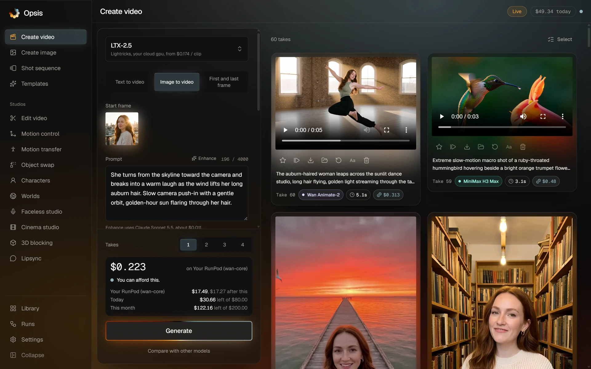
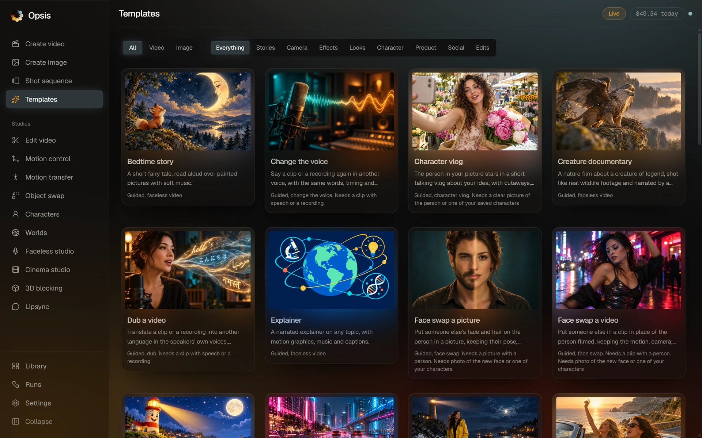
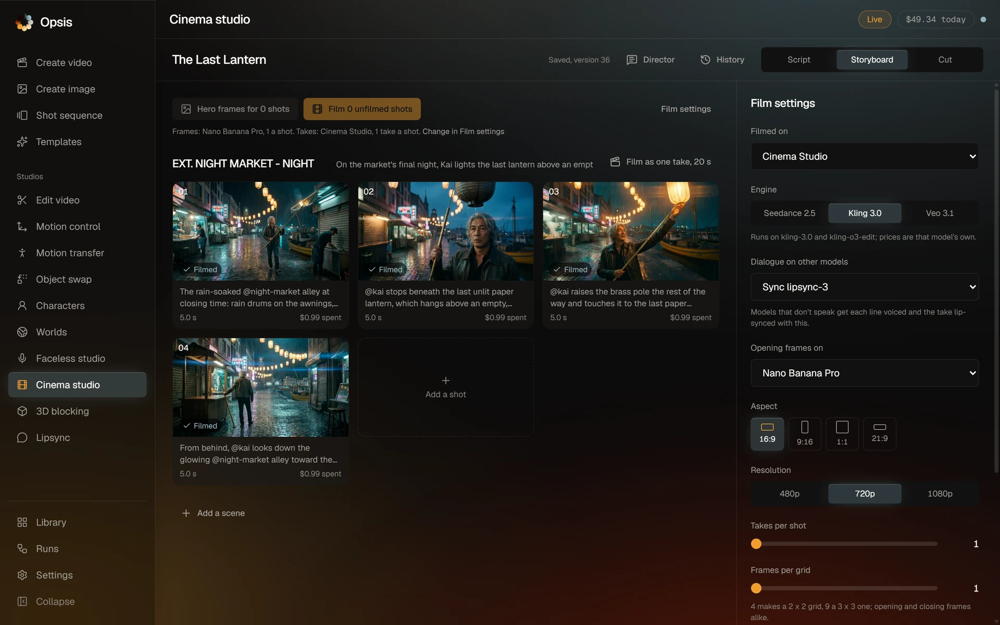
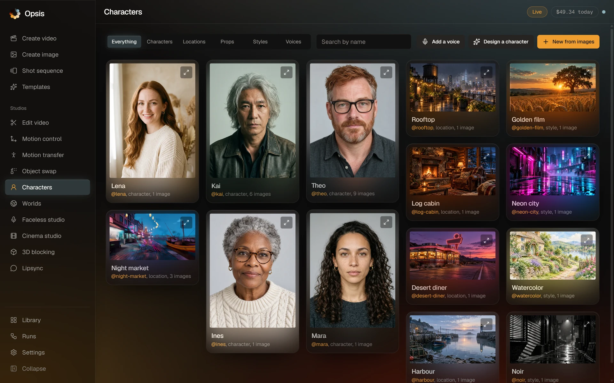
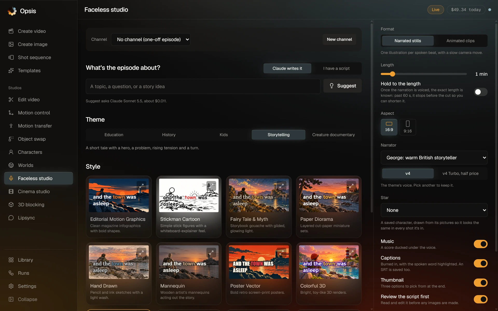
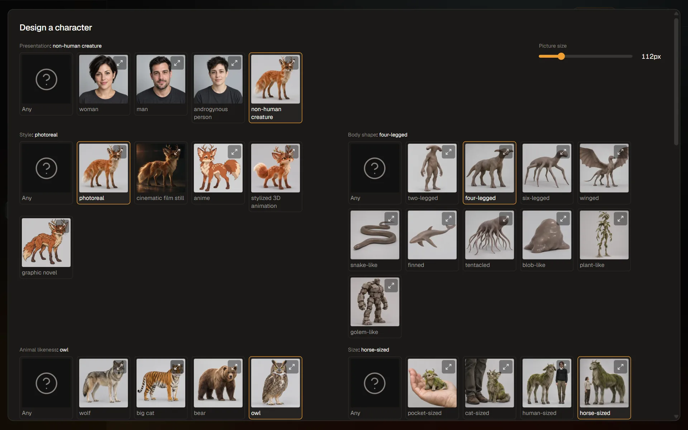
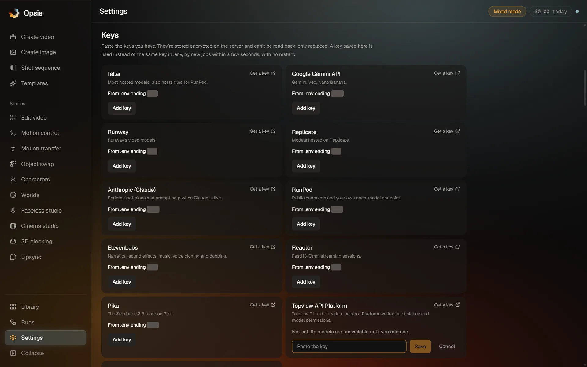
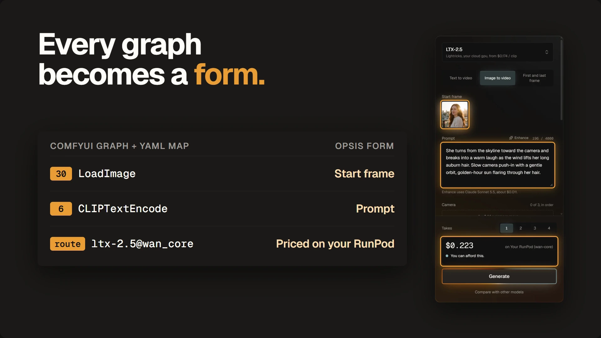
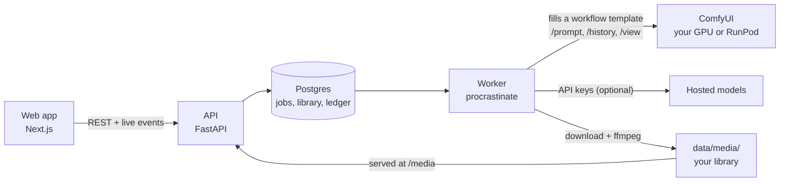
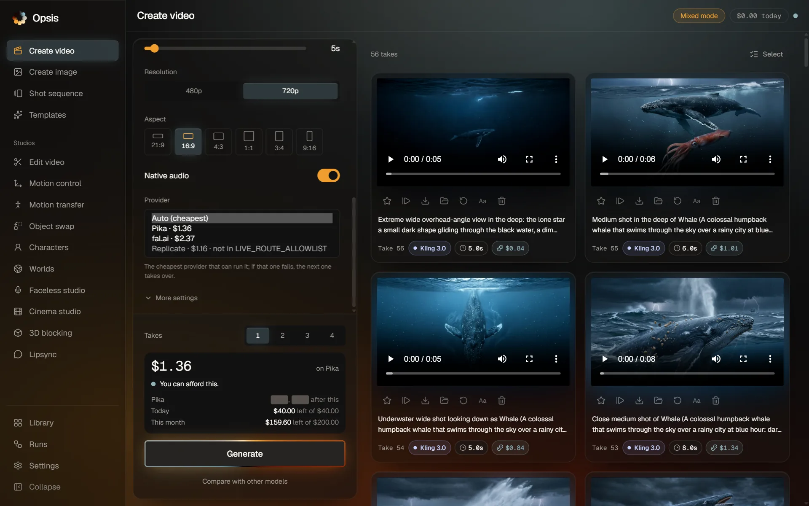

<p align="center">
  
</p>

<h1 align="center">Opsis</h1>

<p align="center">
  <b>The open-source AI film studio.</b><br>
  Self-hosted and built on ComfyUI. Hosted models are one API key away.
</p>

<p align="center">
  <a href="LICENSE"></a>
  
  
  
</p>

<p align="center">
  <a href="https://github.com/user-attachments/assets/dbfe8017-43c7-4855-b677-b80629ac9910">Launch film</a> ·
  <a href="#quick-start">Quick start</a> ·
  <a href="#open-models-on-your-gpu">Your GPU</a> ·
  <a href="#how-it-works">How it works</a> ·
  <a href="#documentation">Docs</a>
</p>

https://github.com/user-attachments/assets/be0ec906-b867-458f-8845-0da3952e5957

Opsis is a self-hosted video studio in the spirit of Higgsfield. You pick a model, set a few controls that matter,
and the take lands in your library. You never wire a node graph. Open models such as Wan 2.2, LTX-2.5 and FLUX.2 klein
run as real ComfyUI workflows, on your own GPU or your own RunPod endpoint. Add API keys and you also get hosted models from fal.ai, Google,
Runway, ElevenLabs and others: more than 60 models in all, each take priced before it runs.

The launch film above was made in Opsis: its characters, worlds, voices, score and the
three short films in it.



## Features

| Studio | What you get |
|---|---|
| **Create video and image** | Text or a picture to video and image across local, RunPod and hosted models, with a camera and look director |
| **Shot sequence** | Shots that continue from each other's last frame, joined into one cut |
| **Edit video, Motion control, Motion transfer** | Change or restyle a clip by instruction, stack camera moves from a library of 65, copy a performance onto a character |
| **Object swap, Face swap** | Click an object, track it through the clip and replace it; swap a face in a picture or a clip |
| **Characters** | Design a person or a creature from picture tiles, then `@mention` them in any prompt; reference sheets, trained LoRA identities |
| **Faceless Studio** | A topic becomes a narrated short: script review, shots, voice, music, captions, thumbnail |
| **Cinema Studio** | Script to storyboard to takes to a timed cut, with an AI director chat and dialogue lip-sync |
| **3D blocking and Worlds** | Block a scene with 3D models in Gaussian-splat worlds, then re-render the passes as live action |
| **Lipsync, voices, music, dubbing** | Talking shots, cloned voices, songs, dubbing into other languages |
| **Templates** | One-form recipes: music videos, character vlogs, creature documentaries, effects |

<table>
  <tr>
    <td width="50%"><br><sub><b>Templates</b>: a finished story from one form</sub></td>
    <td width="50%"><br><sub><b>Cinema Studio</b>: a storyboard of shots, each with its takes and cost</sub></td>
  </tr>
  <tr>
    <td width="50%"><br><sub><b>Characters</b>: people, places and styles you <code>@mention</code></sub></td>
    <td width="50%"><br><sub><b>Faceless Studio</b>: a narrated short from a topic</sub></td>
  </tr>
  <tr>
    <td width="50%"><br><sub><b>Design a character</b>: a person or a creature from picture tiles</sub></td>
    <td width="50%"><br><sub><b>Settings &gt; Keys</b>: paste provider keys in the app, stored encrypted</sub></td>
  </tr>
</table>

Across every studio:

- **Priced before it runs.** Each request is estimated and checked against your daily and monthly limits, and the
  Create form shows whether the provider's balance covers it. Every charge is recorded and, where the provider
  reports its bill, corrected to match.
- **Mock first.** By default every hosted and RunPod model answers with a labelled test clip, so the app works
  without a GPU or keys. Local models run for real once ComfyUI is up and has their files.
- **Characters stay themselves.** A saved character's pictures attach to any prompt that mentions them; models that
  take a LoRA load their trained identity instead.
- **Models are data.** Each model is one YAML file in [`registry/`](registry/): its modes, parameters, prices and
  the providers that run it.

## How it works



A local or RunPod model is a ComfyUI workflow in API format plus a short `.map.yaml` that names the node inputs the
form fills: prompt, seed, size, length, start frame. The worker fills the template, queues it on ComfyUI's `/prompt`,
follows `/history`, downloads the result through `/view` and stores it in `data/media/`. Graphs for your RunPod
endpoint sit in the same folder (`runpod_*.json`) and travel with each request, so adding one needs no image rebuild.



## Quick start

Mock mode needs no GPU and no keys. You need, on Windows, macOS or Linux:

- [Docker](https://docs.docker.com/get-docker/) running, for Postgres
- Node 22 or newer with pnpm 9 (`corepack enable` sets up the pinned pnpm)
- [uv](https://docs.astral.sh/uv/), which installs Python 3.12 for you
- [ffmpeg](https://ffmpeg.org/download.html) on your PATH

```bash
git clone https://github.com/sanchezrobertodev/opsis.git
cd opsis
cp .env.example .env
pnpm db:up        # Postgres in Docker, on port 5433
uv sync
pnpm install
pnpm db:migrate
pnpm dev          # API on :8400, the worker, and the web app on :3000
```

Open http://localhost:3000. Settings shows whether the database, ffmpeg and the local engine are found.

Asking an AI agent to set it up? Point it at [`AGENTS.md`](AGENTS.md): the same steps with a check after each
one, the ports, and what it should leave to you (keys and spending).

### Or all of it in Docker

With only Docker installed, one command builds and starts the database, the API, the worker and the web app
(`compose.yaml`; it runs the migrations first):

```bash
cp .env.example .env
docker compose up --build
```

Open http://localhost:3000. ComfyUI stays on your machine, next to the GPU: the containers reach it at
`host.docker.internal:8188` (set `OPSIS_COMFYUI_URL` for another address; on Linux start ComfyUI with `--listen`).
Media is kept in `./data` and the database is the same one `pnpm db:up` starts, so you can switch between this and
`pnpm dev` (not both at once: they use the same ports). `OPSIS_WEB_PORT`, `OPSIS_API_PORT` and `OPSIS_DB_PORT`
change the ports; rebuild after changing the API's, since the web app is built for it.

## Open models on your GPU

Local models are free, work offline and run in every mode, mock included. You need
[ComfyUI](https://github.com/comfyanonymous/ComfyUI) 0.34 (the portable download on Windows, or a manual install) and an
NVIDIA GPU with 12 GB of memory or more.

1. Start ComfyUI on its default port. `.env` already points there: `COMFYUI_URL=http://127.0.0.1:8188`.
2. In the Opsis folder, on the computer that runs ComfyUI, see what fits your GPU:

   ```bash
   uv run python scripts/setup_local.py
   ```

   It lists every local model as ready, too big for your GPU, or with what it still needs: a node pack, model files
   and how many GB.
3. Set up the ones you want, or every one that fits:

   ```bash
   uv run python scripts/setup_local.py --model wan-2.2-5b --model flux-2-klein-4b
   uv run python scripts/setup_local.py --fits
   ```

   It says what it will do and asks first. It clones a model's node packs into `custom_nodes/` at the commit Opsis was
   checked against, and installs their Python packages into ComfyUI's own Python, without changing its torch,
   transformers or numpy. Then it downloads the model files into the folders ComfyUI reads; a download that stops
   resumes where it left off. Restart ComfyUI when a node pack was added; new model files are seen within a minute.

**Settings > Local models** shows which local models are ready and what the others are missing. The model
pickers list them first, marked free, and a form starts on one once it's ready. A model that also runs on RunPod or a hosted API runs on your GPU first, for free, once ComfyUI can run
it.

| Model | What it does | GPU memory |
|---|---|---|
| Wan 2.2 5B (local) | Text or a picture to video | 12 GB |
| FLUX.2 klein 4B (local) | Text to image, upscaled 1.5× | 12 GB |
| ESRGAN upscale (local) | A clip of up to 5 s and 720p made 2 to 4 times bigger (Edit video > Upscale) | 6 GB |
| Qwen3-TTS (local) | Speech in nine stock voices, or in a character's voice from a recording (node pack) | 12 GB |
| InfiniteTalk | A picture and a voice to a talking clip, 480p, up to 11.8 s (Lipsync, Talking shot) | 12 GB |
| InfiniteTalk dub (local) | The mouths in a clip moved to a voice, 480p, up to 15 s (node pack) | 12 GB |
| Wan 2.2 14B Fast | A picture to video | 16 GB |
| Wan 2.2 Fun Camera | Camera moves from a picture | 16 GB |
| Wan-Move | Motion paths drawn on a picture | 16 GB |
| Wan 2.2 camera copy (Uni3C) | The camera of a reference clip | 16 GB |
| LTX-2.5 | Text, a picture, or a first and last frame to video, with sound | 24 GB |
| Wan Animate-2 | Motion transfer | 24 GB |
| Wan VACE masked edit | Masked edits (Object swap) | 24 GB |

The memory figures and run times are estimates, apart from Wan 2.2 5B and FLUX.2 klein: the bigger graphs were tuned
on RunPod's 96 GB card and haven't been measured on a consumer one. Weights larger than the card are streamed from
system RAM, which is slower, so 64 GB of RAM helps. LTX-2.5 and Animate-2 use int8 files made for the comfy-kitchen
kernels that ComfyUI 0.34's CUDA 13 build (the portable download) turns on. LTX-2.5's files are gated: accept the
license at [huggingface.co/Lightricks/LTX-2.5](https://huggingface.co/Lightricks/LTX-2.5) and set `HF_TOKEN` first.
Every file, its folder and its source are listed in
[`infra/runpod/wan-core/models.yaml`](infra/runpod/wan-core/models.yaml).

On a recent 12 GB card, a Wan 2.2 5B draft take (768×448, 3 s) takes about 70 seconds and a standard one (1280×704,
5 s) about seven minutes. The first job after ComfyUI starts also loads the model, about 40 seconds more. Sample prompt:
*A small red sailboat drifts on a calm alpine lake at sunrise, gentle ripples, pine forest.*
([what Wan 2.2 5B made from it](docs/demo/wan22-5b-sailboat.mp4) on a 12 GB card.) While a take renders, its card
shows ComfyUI's own progress and the sampler's latest frame, and a queued or running job can be canceled from its
card. To see what runs, read [`workflows/comfy/wan22_ti2v_5b.json`](workflows/comfy/wan22_ti2v_5b.json) and its
[`.map.yaml`](workflows/comfy/wan22_ti2v_5b.map.yaml).

**LoRAs**: put a LoRA file in ComfyUI's `models/loras/` and pick it under **More settings** with Wan 2.2 5B or
FLUX.2 klein, with a strength. The list is read from ComfyUI each time the form opens.

### Voices and lip sync on your GPU

**Qwen3-TTS (local)** (Apache-2.0): give a character a voice sample on their page, pick Qwen3-TTS under Film settings >
Lines voiced with, and Cinema Studio voices that character's lines from the recording. Its node pack downloads each
model the first time it speaks, into `models/qwen-tts/`: 4.5 GB for the stock voices, 4.5 GB more for cloning.

Film settings > Lip-synced with picks how each take is matched to its lines, free or paid. **InfiniteTalk dub
(local)** moves the mouths in the take, keeping its motion. **InfiniteTalk** on your GPU, like the paid avatar
models, redraws the take from its first frame speaking the lines, so the take's own motion is lost. Both redraw the
frame at 480p, so the background can shift a little.

### Your own workflows

Any graph that runs in your ComfyUI can be a model in Opsis. Export it with Workflow > Export (API), then draft
the model from it:

```bash
uv run python scripts/import_comfy_workflow.py my_workflow_api.json --id my-model --name "My model"
```

It guesses which node inputs the prompt, seed, size, length and media fill, writes the graph, its map and a model
YAML into your own folders (`data/workflows/comfy/` and `data/registry/`, which a `git pull` never touches and a
server reads without a rebuild), and checks they load. [docs/comfy-workflows.md](docs/comfy-workflows.md) says what
to review.

### Larger open models on your RunPod

[`infra/runpod/wan-core/`](infra/runpod/wan-core/) sets up a RunPod serverless endpoint running the same ComfyUI 0.34,
for the graphs that need a bigger GPU: LTX-2.5 (text, picture, or first and last frame to video, with sound; LTX-2
Community License), Wan 2.2 14B Fast, Fun Camera, Wan-Move, VACE, Animate-2 and Uni3C. Its README creates the
endpoint and a network volume for the 180 GB of model files (about $14 a month); then set `RUNPOD_API_KEY` and
`RUNPOD_WAN_CORE_ENDPOINT` in `.env`. Jobs are billed by the GPU second, and every take shows its price first.

## Hosted models and spending

1. Paste the keys you have in **Settings > Providers**; each one links to where you get it. They're stored encrypted in the
   database (with `KEYS_SECRET`, or `data/keys.secret`, made on first start: keep a copy, since a lost secret means
   pasting the keys again) and used at once, with no restart. Keys in `.env` work too; a key saved in Settings wins. A
   model whose provider has no key is simply unavailable.
2. Raise `PROVIDER_MODE` to `mixed` or `live`, and `LLM_MODE` to `live` for Claude. This is a ceiling: the switch in
   Settings can pick that mode or a safer one, never more.
3. Restart `pnpm dev`, set your daily and monthly limits in **Settings > Spending**, and pick the mode in
   **Settings > General**.

To try one paid route at a time, use `PROVIDER_MODE=mixed` with only that route allowed, for example
`LIVE_ROUTE_ALLOWLIST=kling-3.0@fal`. The price line under Takes names the provider a take will run on, and
Settings shows where the money went, by feature and by model.

When a model has more than one provider (Seedance 2.5 on Replicate, Pika or fal; Veo 3.1 on Google or fal; GPT Image
2.5 on Codex or fal), the Create form shows a **Provider** select. **Auto (cheapest)**, the default, runs each take on
the cheapest provider that can and falls back to the next if it fails. A provider you pick runs every take, including
"another take" from a take's card, and never falls back. Each option shows its price, and one that can't run the take
says why (no key, mock mode, ComfyUI isn't running).



<details>
<summary><b>GPT Image through your ChatGPT plan</b> (optional)</summary>

GPT Image 2.5 can draw from a ChatGPT plan's allowance through the
[Codex CLI](https://developers.openai.com/codex/cli) instead of being billed per picture on fal. These steps are
for a desktop setup; on the Linux server see
[infra/server/README.md](infra/server/README.md#gpt-image-through-your-chatgpt-plan) instead.

1. Install the Codex CLI and sign in with your ChatGPT account: `codex login`. `codex login status` should say
   "Logged in using ChatGPT". An API-key sign-in bills per picture, which defeats the purpose.
2. Set `CODEX_BIN` in `.env` to the full path of the `codex` program (`where codex` on Windows, `which codex`
   elsewhere), then restart the API and the worker.
3. **Settings > Providers** shows **Codex (your ChatGPT plan): Ready**. The model picker then lists
   GPT Image 2.5 as Free.

It follows the Mock / Mixed / Live switch like any provider. It is slow (about 90 s a picture), and Codex picks the
size, so pictures are cropped to the shape you asked for. A picture Codex can't draw (the plan's usage limit, a
refusal) moves on to fal and is billed there. Check OpenAI's terms for this use of a plan. On a desktop Codex runs
as the worker's user and could read what the worker can; the server setup runs it in its own container, apart from
the studio's keys and files, with its own sign-in.

</details>

### Add a hosted model

A model a provider here already serves (on fal, Replicate, Runway and the rest) is one YAML file and no code:

1. Copy a similar model from `registry/models/<type>/` to `data/registry/models/<type>/<id>.yaml`. That folder is
   yours: a `git pull` never touches it, and the API and the worker read it within a second, on a server too. Give
   the copy its own `id` and route ids (`<id>@fal`).
2. Point the route at the provider's endpoint and map the fields it takes (`map:`; the CLAUDE.md section "Registry
   expressions and mapping" lists what a route can do). Price it from the provider's pricing page, with `verified`
   (the day you checked) and `source` (the page's link).
3. Keep one `examples:` entry, marking the cheapest `smoke: true`.
4. Check it, for free: `uv run pytest apps/server/tests/contract -k <id>`. A mistake also shows in `/health`; the
   studio keeps running on everything else meanwhile.
5. Optionally try it once for real, capped: `uv run python scripts/smoke_live.py --routes <id>@fal --cap 0.50
   --confirm-spend` (the API in `mixed` mode with that route allowed, or `live`).

A file with a built-in model's id replaces that model, with a warning each time the registry loads. Presets and
templates of your own go in `data/registry/presets/` and `data/registry/templates/` the same way.

## Drive it from Claude

The API serves an MCP server at `/mcp` (Streamable HTTP). With it, Claude can list templates, estimate a run,
start it once you agree, follow it, answer its reviews and find results. Every spending check still applies. No tool
can change the limits, the mode switch or keys. Like the API, it has no login, so keep it on your own network or
tailnet.

- **Claude Code** on a machine that can reach the API:
  `claude mcp add --transport http opsis http://localhost:8400/mcp`. On the Linux server setup, use
  `https://<host>.<tailnet>.ts.net:19444/mcp`.
- **Claude Desktop:** add it as a local server in `claude_desktop_config.json`. The
  [`mcp-remote`](https://www.npmjs.com/package/mcp-remote) bridge runs on your computer, so it reaches the tailnet:
  ```json
  { "mcpServers": { "opsis": { "command": "npx", "args": ["-y", "mcp-remote", "https://<host>.<tailnet>.ts.net:19444/mcp"] } } }
  ```
- **claude.ai, mobile and custom connectors** connect from
  [Anthropic's cloud](https://support.claude.com/en/articles/11175166-get-started-with-custom-connectors-using-remote-mcp),
  not from your device. They need a public address, so they can't reach a tailnet-only studio. Don't expose `/mcp`
  publicly: it has no login.

Ask something like "make a history short about the Titanic's band, tell me what it costs first". When the run can be
billed (generation Mixed or Live, or Claude Live), Claude shows the estimate and waits for your yes. Above your confirmation limit, the run starts only with that estimate sent back.

## Troubleshooting

| Symptom | Fix |
|---|---|
| "Local ComfyUI isn't running" | ComfyUI isn't reachable at `COMFYUI_URL`. Start it, or check the port. In Docker, the address is `OPSIS_COMFYUI_URL` (default `http://host.docker.internal:8188`); on Linux, ComfyUI must listen beyond 127.0.0.1 (`--listen`). |
| "ComfyUI is missing ..." or "ComfyUI has no ... node" on a model | Run `uv run python scripts/setup_local.py --model <id>` on the computer with ComfyUI. |
| Out of memory on a local job | Use Draft quality or close other GPU apps. One local job runs at a time. |
| The API won't start on Windows | Run it as `python -m studio.api` (what `pnpm dev` does), not bare uvicorn. |
| The library is empty after updating | Before the rename to Opsis the database volume was `ai-media-studio_pgdata`. Stop both databases (`docker compose -p ai-media-studio -f infra/docker-compose.yml down`, then the same with `-p opsis`), remove the new empty volume (`docker volume rm opsis_pgdata`), copy the old one with `docker run --rm -v ai-media-studio_pgdata:/from -v opsis_pgdata:/to postgres:18 cp -a /from/. /to/`, then `pnpm db:up`. |

## Limitations

- **Single user.** There is no sign-in. Run it on your own machine or a private network such as Tailscale, never
  on the open internet.
- **Media is on local disk.** Files live under `data/media/`, so back that folder up yourself. For the database,
  `uv run python scripts/backup_db.py` dumps it to `data/backups/` and `uv run python scripts/restore_db.py --check`
  test-restores the newest dump.
- **Prices go stale.** Each price in `registry/` carries the date it was verified, and the registry lint warns once
  that date is more than 30 days old. The weekly provider check (`uv run python scripts/fetch_provider_schemas.py`,
  free) also compares the prices with fal's pricing API, Pika's and Reactor's price lists and RunPod's GPU catalog,
  and lists the rest to check by hand; it reports and never edits the YAML. fal (with an admin key) and your RunPod
  endpoint report their bills, which correct the charges; Google, ElevenLabs and Replicate stay estimates.
- **Hosted models need your own accounts** and cost money. The local routes are the ones that are free and open
  end to end.

## Development

```bash
pnpm test    # Python unit, registry-contract and database integration tests
pnpm lint    # ruff, eslint and tsc
pnpm e2e     # Playwright against the mock provider
pnpm gen     # regenerate the TypeScript API client after an API change
```

`pnpm test` needs `pnpm db:up` and uses a separate `studio_test` database. Install the e2e browser once with
`pnpm --filter @opsis/web exec playwright install chromium`. `pnpm e2e` reuses a running `pnpm dev`, so stop a dev
server that is in Live mode first.

Adding a model, a preset or a template is mostly YAML; [CLAUDE.md](CLAUDE.md) lists the conventions.

## Documentation

- [`docs/PLAN.md`](docs/PLAN.md): the roadmap
- [`docs/research/06-architecture-blueprint.md`](docs/research/06-architecture-blueprint.md): the detailed design
- [`infra/server/`](infra/server/): an example Linux deployment (rootless Podman, systemd timers, nightly backups)
- [`infra/runpod/wan-core/`](infra/runpod/wan-core/): your own RunPod endpoint for the larger open models
- [`docs/local-model-storage.md`](docs/local-model-storage.md): choosing ComfyUI's model folder from Settings
- [`docs/pika.md`](docs/pika.md), [`docs/reactor.md`](docs/reactor.md), and [`docs/topview.md`](docs/topview.md): optional providers

## License

[Apache-2.0](LICENSE). See [NOTICE](NOTICE) for third-party terms: Remotion's license, model licenses and how
ComfyUI is used.
